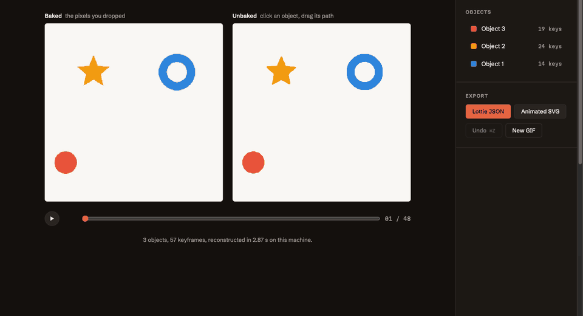

# Unbake

**Turn a flattened motion-graphics animation back into editable objects.** Drop a GIF: Unbake finds the shapes, their colours and their motion (position, rotation, scale, and lines that draw themselves), turns it into eased keyframes like hand-made animation, lets you select an object, drag its motion path, retime its keys on a timeline or recolour it, and exports the result as Lottie JSON or animated SVG.

**[▶ Try it in your browser](https://fredbourouliou.github.io/unbake/)** — Python, OpenCV and SciPy run locally through WebAssembly; nothing is uploaded.



## What works, what doesn't (yet)

- **Works:** flat 2D motion graphics on a plain background. Rigid shapes that move, rotate and scale (with occlusions and dithered GIFs), and constant-width strokes that draw on, draw off or spin like a loader.
- **Also:** two-colour linear gradient fills that move and turn with their shape (v0.4), and shapes whose outline morphs (v0.5, animated paths; mild morphs are still often taken for rigid shapes).
- **Doesn't yet:** radial or multi-stop gradients, morphing shapes with holes, particles that merge, near-identical colours, photos or 3D.
- On 24 real community animations (loaders, toggles, icons, logos), 18 come back faithful, 3 partial, 3 wrong. Details and every number below.

## Use it from Python

```bash
uv tool install git+https://github.com/FredBourouliou/unbake   # or: uv sync, then uv run unbake …
unbake animation.gif                                          # writes animation.json (Lottie) and animation.svg
```

Run the editor locally: `./scripts/build_web.sh && python3 -m http.server -d web 8000`. Run the tests: `uv run pytest`.

## How it works

1. **Palette.** Background and dominant colours; every pixel labelled, ignoring dithering and antialiasing blends.
2. **Strokes.** Over the whole animation, a line that draws itself only ever covers its own path: a thin region whose area changes. Its skeleton gives the centre line (refined to sub-pixel), the distance to the edges gives the width, and each frame gives the visible interval along the path.
3. **Rigid objects.** Connected regions per colour, linked across frames, pieces cut by an occluder joined back. Each object's clearest view becomes a template fitted on every frame for position, rotation and scale; pixels hidden by another object are not counted against it.
4. **Keyframes.** Each channel is split at its extrema, then wherever one cubic-Bézier easing curve cannot follow it; this is what the editor edits and what the exports play (native Lottie easing, SVG keySplines, trim paths for strokes).

## How it was built and measured

Unbake started as a one-week feasibility spike with stop criteria written before the code, synthetic animations with known sources, and holdout sets used once. The log below is kept as it happened, failures included.

### The question

Can objects and their motion be reconstructed from rendered frames cleanly enough that editing them is useful?

### Method

1. `unbake.corpus` generates synthetic animations whose source is known (shapes, colours, per-frame position, rotation, scale), exported as palette GIFs. Three levels:
   - **easy**: 1–3 shapes, distinct colours, no overlap, no dithering
   - **medium**: 3–5 shapes, overlaps, Floyd–Steinberg dithering
   - **hard**: 4–6 shapes, overlaps, dithering, near-identical colours
2. The reconstruction only sees the GIF. The ground truth is used for scoring only.
3. Dev set (seeds 0…) is used while developing. **Holdout set (seeds 10 000…) is only run for the final numbers.**

### Stop criterion (written before any reconstruction code)

Measured on the **medium holdout** set, per ground-truth object and frame:

| Metric | Go if |
|---|---|
| Identity: object-frames attributed to the right object | ≥ 90 % |
| Median position error | ≤ 2 px |
| Median rotation error (modulo the shape's symmetry) | ≤ 5° |
| Mean IoU between input frames and the re-rendered reconstruction (per colour region) | ≥ 0.90 |

- All four met on medium → build the editor.
- Met on easy but not on medium → one more iteration focused on occlusions, then decide.
- Not met on easy → stop: the classical approach is not enough.

The hard set is reported but not part of the decision.

**Correction logged on day 1:** the first corpus could give two shapes the same colour on the medium level (a generator bug: identical/near colours are meant to be a hard-level feature only). Found while inspecting the dev set; fixed and both sets regenerated before the holdout set had ever been scored.

**Correction logged on day 1 (holdout run):** the first holdout run crashed on `easy-10007` before printing any metric: the GIF encoder had merged identical consecutive frames and extended their duration, and the loader ignored durations. The loader now decodes at a constant frame rate using frame durations (needed for real-world GIFs anyway). No reconstruction logic was changed; the holdout set was then run once.

### v0.2: animated strokes (stop criterion written before any detection code)

New corpus level **strokes**: 1–3 constant-width strokes (circle loops, waves, zigzags; round or butt caps) that draw on, draw off, draw on then off, or spin like a loader, mixed with 0–2 rigid shapes. Ground truth: centre line, width, cap, per-frame visible interval. Dev seeds 0–29, holdout seeds 10 000–10 029.

| Metric (strokes holdout) | Go if |
|---|---|
| Ground-truth strokes recovered as strokes | ≥ 90 % |
| Mean IoU of each stroke rendered alone, ground truth vs reconstruction | ≥ 0.80 |
| Mean region IoU, whole frame (as in v0.1) | ≥ 0.85 |

Non-regression on the medium holdout: the four v0.1 thresholds still hold, and fewer than 5 % of medium samples get a (false) stroke.

Then the 24 real animations are re-run and reported before/after, with no threshold.

**v0.2 holdout result (run once, commit `1e05f29`): not met, narrowly.** Strokes recovered 98.3 % (✓), mean stroke IoU **0.791** (✗, threshold 0.80), region IoU 0.855 (✓), medium samples with a false stroke **1/20 = 5 %** (✗, threshold < 5 %). v0.1 non-regression on the medium holdout holds: identity 96.9 %, 0.14 px, 0.47°, IoU 0.929.
This holdout set is now spent: after one more iteration on the dev set, the criterion is re-checked on a fresh holdout (seeds 20 000–20 029 for strokes, 20 000–20 019 for medium), never seen before.

**v0.2 on the fresh holdout (run once, commit `b697706`):** strokes recovered 97.1 % (✓), mean stroke IoU **0.822** (✓), region IoU 0.866 (✓), medium samples with a false stroke **1/20 = 5 %** (✗, threshold < 5 %). v0.1 non-regression holds (identity 95.3 %, 0.15 px, 0.37°, IoU 0.936).
Verdict: three of four criteria met. The remaining failure is a rigid ring occasionally classified as a stroke (visually close, wrong object type for editing). Logged as a known issue; it will be fixed and checked on yet another unseen holdout, not on this one.

### v0.3: easing curves (criterion written before the code)

Keyframes are currently joined by straight lines, so a bouncing ball needs a keyframe almost every frame. v0.3 joins them with cubic-Bézier easing curves (as in CSS, After Effects and Lottie), with keys placed at extrema first.

| Metric | Go if |
|---|---|
| Keyframes in the export, relative to v0.2 (same reconstructions) | ≤ 50 % |
| Region IoU of the Lottie export rendered by lottie-web, relative to v0.2 | drop ≤ 0.01 |

Measured on dev while developing, then once on a fresh holdout (seeds 30 000+: 20 medium, 20 strokes).

**Result on the fresh holdout (run once, commit `d379c72`): go.** Keyframes 6 602 → 2 825 (**43 %** of v0.2), Lottie region IoU 0.896 → 0.898 (no drop; slightly better). Dev set: 42 %, +0.002. The bouncing-ball sample goes from 137 to 54 keyframes in total; the ball's vertical motion from 47 keys to 10, one per bounce extreme.

### v0.3.1: false strokes (criterion written before the fix)

The one v0.2 criterion never met: a rigid shape occasionally comes back as a stroke. On a wider dev set (300 medium samples, seeds 0–299) it happens on **4/300**: a ring that scales in place, and three shapes whose swept area happens to contain a thin arc. Too rare to measure on 20 samples, so the check uses a larger fresh holdout: **seeds 40 000–40 199 for medium (200 samples) and 40 000–40 059 for strokes (60)**, never generated before, run once.

| Metric | Go if |
|---|---|
| Medium samples with a false stroke | ≤ 1 % (at most 2 of 200) |
| Ground-truth strokes recovered as strokes | ≥ 95 % |
| Mean IoU of each stroke rendered alone | ≥ 0.80 |
| Mean region IoU on the strokes level | ≥ 0.85 |

Non-regression on the same 200 medium samples: the four v0.1 thresholds still hold. The 24 real animations are re-run and reported before/after.

The fix: a candidate stroke, rendered with its fitted width and trim, must cover its own pixels nearly as well as a one-pixel edge error allows (IoU ≥ 0.77 × (w − 1)/(w + 1)). A first version with a plain IoU threshold rejected the thin real strokes of *colorline*; normalising by the width fixed that before the holdout was generated.

**Result on the fresh holdout (run once, commit `6404f6e`): go.** Medium samples with a false stroke **0/200** (✓), strokes recovered 96.9 % of 127 (✓), mean stroke IoU 0.804 (✓, narrowly), region IoU 0.881 (✓). Non-regression on the 200 medium samples: identity 96.8 %, 0.15 px, 0.43°, IoU 0.935 (all ✓). Dev: 4/300 → 0/300. The 24 real animations come back exactly as before.

### v0.4: gradient fills (criterion written before the reconstruction code)

A new corpus level, **gradients**: 2–4 overlapping shapes, about half of them (at least one per sample) filled with a two-colour linear gradient that moves and turns with the shape, dithered GIFs. Today such a shape comes back as two or three flat fragments: on 40 dev samples, **0 % of gradient shapes** are recovered as one gradient object, identity 85.6 %, mean foreground colour error 9.5 / 255 (`scripts/evaluate_gradients.py`).

| Metric (gradients level) | Go if |
|---|---|
| Gradient shapes recovered as one object with a gradient fill | ≥ 90 % |
| Identity, all shapes (as in v0.1) | ≥ 90 % |
| Median position error | ≤ 2 px |
| Mean colour error on the foreground, ground truth vs reconstruction, both undithered | ≤ 4 / 255 |
| Lottie export rendered by lottie-web vs the reconstruction's own render, foreground | ≤ 4 / 255 |

Non-regression: medium samples given a gradient by mistake ≤ 5 %, and the four v0.1 thresholds on medium still hold. Measured on dev while developing, then once on a fresh holdout (seeds 50 000+: 60 gradients, 100 medium).

How it works: once dithering is blurred away, the inside of a flat shape has one colour and the inside of a gradient fill has a colour that is an affine function of position, with all channels changing along one direction. Smooth regions (no colour edge) that fit such a model with a large colour range are gradient fills; regions from different frames are grouped by colour line (a partly hidden fill covers part of the same line), and each group is tracked like one more palette colour. The gradient is then fitted in the object's local frame over all its views; for a disc, whose outline shows no rotation, the gradient's direction gives it.

**Result on the fresh holdout (run once, commit `3994e5c`): not met on one criterion.**

| Metric | Result | |
|---|---|---|
| Gradient shapes recovered as one gradient object | 100 % of 101 | ✓ |
| Identity | 95.6 % | ✓ |
| Median position error | 0.21 px | ✓ |
| Foreground colour error vs ground truth | **6.69 / 255** | ✗ (≤ 4) |
| Lottie export (lottie-web) vs own render | 2.96 / 255 | ✓ |
| Medium samples given a false gradient | 0/100 | ✓ |
| v0.1 thresholds on medium | 96.4 %, 0.15 px, 0.43°, IoU 0.932 | ✓ |

Why the colour criterion fails, measured after the fact: the threshold was set without measuring what flat shapes already score on it. On the same holdout, **flat medium shapes score 6.16** with the same metric. Inside shapes the error is 2.65 (gradients) and 2.13 (flat); almost all of the rest comes from a 2-pixel band along the outlines, where a sub-pixel outline difference (0.35 px on average) meets a high-contrast edge. So gradient colours are right, but the criterion as written is not met, and outline precision (for all shapes, not gradients) is what would move it.

Two more things to report. Four of the 60 holdout seeds could not be generated (four gradients need eight palette colours, the palette has seven); the evaluation ran on the 56 others, and the generator now drops extra gradients instead (existing samples unchanged). On the 24 real animations, *turbine*'s purple disc now comes back as one gradient instead of two flat pieces, which looks closer but lowers its per-colour region score (0.88 → 0.51, a metric that labels each pixel with the nearest flat colour); the others are unchanged.

### v0.5: morphing shapes (criterion written before the reconstruction code)

A new corpus level, **morph**: 1–3 shapes, at least one whose outline morphs between two primitives (circle, square, rect, triangle, star; blended point by point along rays from the centre) while it moves, dithered GIFs. Today a morphing shape comes back as a rigid template that scales: on 40 dev samples, **0 %** are recovered with an animated outline, and their mean per-frame IoU is **0.795** (`scripts/evaluate_morph.py`). For calibration, measured before setting the thresholds this time: rigid shapes reach a mean per-frame IoU of 0.91 on the same samples and on medium.

| Metric (morph level) | Go if |
|---|---|
| Morphing shapes recovered as one object with an animated outline | ≥ 90 % |
| Mean per-frame IoU of each morphing shape, rendered alone | ≥ 0.88 |
| Identity, all shapes | ≥ 90 % |
| Lottie export rendered by lottie-web vs the reconstruction's own render, foreground | ≤ 4 / 255 |

Non-regression: medium samples given a morph by mistake ≤ 5 %, and the four v0.1 thresholds on medium still hold. Measured on dev while developing, then once on a fresh holdout (seeds 60 000+: 60 morph, 100 medium).

How it works: an object is a morph when no rigid pose of its outline explains it on the frames where it is seen whole (not touching another colour or the border): the mean distance between the best-placed rigid outline and the true edge, (1 − IoU) × area / perimeter, exceeds 1.2 px at the 90th percentile. Its outline is then traced on each of those frames, resampled by arc length, aligned frame to frame by cyclic shift, interpolated in time over the frames where it is partly hidden, and lightly smoothed. Exports keep an outline key only where blending linearly between keys would drift by more than 0.6 px.

Two things found on the dev set before the holdout. Measured on 20 medium samples, false morphs looked absent; on 300 they were 6.7 %, mostly rigid shapes whose template had been taken on a view partly hidden by another object (the bite then misfits every whole view). Templates now prefer a view seen whole, which also helps plain rigid reconstruction; with the pose refined before deciding, false morphs fell to 1/300.

**Result on the fresh holdout (run once, commit `7a2b463`): not met on one criterion.**

| Metric | Result | |
|---|---|---|
| Morphing shapes recovered with an animated outline | **87.1 %** of 85 | ✗ (≥ 90 %) |
| Mean per-frame IoU of each morphing shape | 0.918 | ✓ |
| Identity | 97.3 % | ✓ |
| Lottie export (lottie-web) vs own render | 2.36 / 255 | ✓ |
| Medium samples given a false morph | 0/100 | ✓ |
| v0.1 thresholds on medium | 97.4 %, 0.14 px, 0.42°, IoU 0.932 | ✓ |

The 11 missed morphs, looked at after the run: most are mild ones (square ↔ circle, rect ↔ circle, star ↔ rect over a short range) that the best rigid pose, scale included, still explains to within about 1 px, so they stay rigid; their per-frame IoU stays high, which is why the IoU criterion passes. One is never seen whole on any frame. Lowering the 1.2 px threshold would catch more of them but brings back false morphs on rigid shapes; that trade-off is the next thing to work on, on dev, then on a fresh holdout.

Real animations after v0.4 and v0.5, against v0.3: mean region IoU 0.799 → 0.799, nine above 0.9 instead of eight. *trail_loading* goes from 0.63 to 0.92 (its merging trail comes back as a morphing blob), *bouncing_ball* from 0.75 to 0.83; *turbine* drops to 0.51 for the metric reason given in v0.4, and *medal* (already wrong) loses two small pieces.

### Results (holdout, run once, commit `e34f877`)

| Level | Identity | Median position error | Median rotation error | Mean IoU | Objects found / true | Time per GIF |
|---|---|---|---|---|---|---|
| easy | 100.0 % | 0.10 px | 0.19° | 0.953 | 43/43 | 1.1 s |
| medium | 98.6 % | 0.14 px | 0.47° | 0.934 | 86/83 | 1.5 s |
| hard | 43.1 % | 0.82 px | 3.57° | 0.679 | 50/49 | 1.7 s |

**Decision: go.** All four thresholds are met on the medium holdout set (≥ 90 %, ≤ 2 px, ≤ 5°, ≥ 0.90).

The hard level (near-identical colours, same-colour shapes crossing) fails, as expected: colour alone cannot separate objects there. That is the next research problem, not a blocker for the editor.

Reproduce: `uv run python -m unbake.corpus data && uv run python scripts/evaluate.py data/holdout`.

### Real-world test

24 community animations from the LottieFiles collection bundled in [airbnb/lottie-android](https://github.com/airbnb/lottie-android/tree/master/snapshot-tests/src/main/assets/lottiefiles) (loaders, toggles, icons, logos, emoji), rendered to dithered 256 px GIFs and unbaked. No object-level ground truth here: the score is the per-colour-region IoU between input and reconstruction, plus a visual review of every contact sheet (`scripts/real_gifs.py`).

| Visual verdict | Count | Animations |
|---|---|---|
| Faithful | 14 | gears, bell, x_pop, socar_logo, location_pin, retweet, turbine, emoji_wink, check_pop, pagination, preloader, cube_loader, bouncing_ball, medal |
| Partial | 4 | toggle_switch (wrong colour), switch_loop (extra object), simple_loader (missing dot), clock (hands) |
| Fails | 6 | material_loader, loading_semicircle, colorline, play_button, infinite_rainbow, trail_loading |

Mean IoU 0.72 (it penalises thin strokes and small objects heavily: several "faithful" ones score 0.76–0.88). No crash, about 1 s per GIF.

**What breaks:** strokes that draw themselves (Lottie trim paths) and shapes that morph. Unbake models objects as rigid outlines that move, rotate and scale, so a growing arc cannot be represented. This is the most common pattern in real loaders and the next thing to support. Also: gradients, very light strokes close to the background, and particles that merge.

**Fixed after this test:** outlines with several holes (line icons were filled in), and same-colour nested parts being merged (a fragment is now joined to an object only when another object, not background, separates them). Synthetic dev scores unchanged within noise.

**Real-world re-run with v0.2 (same 24 animations):** mean IoU 0.72 → **0.80**.

| Visual verdict | v0.1 | v0.2 |
|---|---|---|
| Faithful | 14 | **18** (+ material_loader, play_button, colorline, loading_semicircle) |
| Partial | 4 | 3 (toggle_switch colour, switch_loop extra object, simple_loader missing dot) |
| Fails | 6 | 3 (clock hands, infinite_rainbow gradient stroke, trail_loading particles) |

Biggest gains: material_loader 0.33 → 0.86, play_button 0.59 → 0.94, colorline 0.34 → 0.85. A branched outline icon (medal) is now explicitly left to the rigid model (a stroke must be one simple path covering ≥ 75 % of its skeleton).

### Comparison

OmniLottie (CVPR 2026, 4B parameters, video → Lottie) is the reference learned approach. Both tools were run on the first 10 medium holdout GIFs; both outputs are Lottie JSON rendered by lottie-web at the input's size and frame count, composited on the input background, and scored with the same per-colour-region IoU.

| | Mean IoU | Mean time per GIF | Valid Lottie |
|---|---|---|---|
| Unbake | 0.934 | 1.0 s (CPU) | 10/10 |
| OmniLottie (official `inference_hf.py`, greedy decoding) | 0.013 | 53 s (Apple M5 Max, MPS) | 10/10 |

OmniLottie returned valid animations that do not depict the input (generic icons instead of the shapes shown). Caveats: it is a generative model that sees 8 sampled frames and is not designed for faithful reconstruction; it was run on Apple MPS (the repository is only tested on CUDA), which may affect its output. Per-GIF numbers: `results/compare-omnilottie.json`. Reproduce: `scripts/compare_omnilottie.py`.

## License

[MIT](LICENSE). The demo samples in `web/samples/` are generated by `scripts/make_samples.py`.
